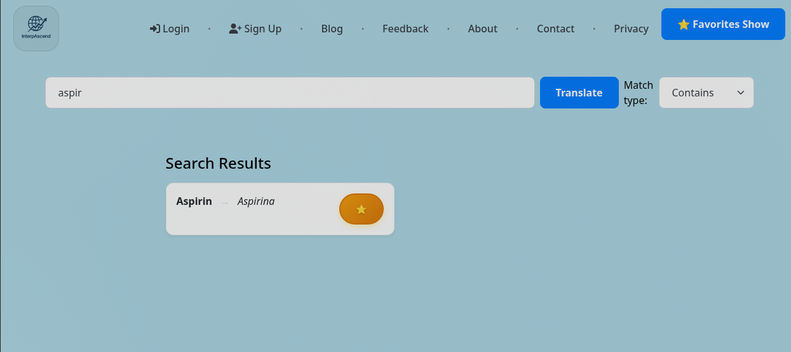
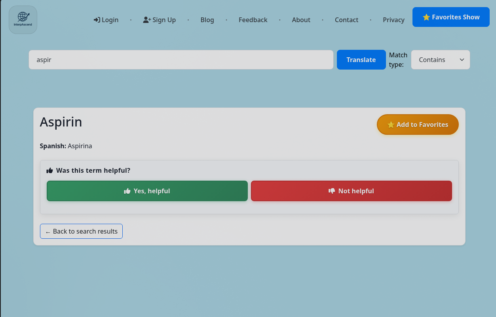

# InterpAscend

A bilingual (English ⇄ Spanish) terminology lookup and study tool for professional interpreters, covering medical, financial, immigration, and government vocabulary.

> **Status: archived.** InterpAscend ran publicly at interpascend.com and reached about **230 monthly users across 11 countries**. I shut it down because of hosting costs and to focus on formal software development studies. The code is published here as a portfolio piece.



## What it did

- **Multi-glossary search:** one query searches medications, diagnoses, MeSH medical terms, Medicare, financial, immigration, government agency, and general-language glossaries at once, with exact / contains / starts-with matching.
- **Automatic language detection:** type in English or Spanish and it translates in the right direction.
- **AI fallback:** when a term isn't in the database, it asks OpenAI for a translation, with retries and backoff.
- **Spaced-repetition study mode:** an SRS module using the SM-2 algorithm, with per-user progress, stats, and HTMX-driven study sessions (see [`docs/srs.md`](docs/srs.md)).
- **Pronunciation support:** text-to-speech and a phonetics pipeline for English and Spanish terms.
- **User features:** accounts with password reset, favorites with export, term feedback, and a blog.



## Stack

- **Backend:** Python 3.11, Django 4.2
- **Database:** PostgreSQL on Google Cloud SQL in production, SQLite locally
- **Frontend:** Django templates, Bootstrap, HTMX
- **Deployment:** Docker, Gunicorn, Google Cloud Run
- **Other:** OpenAI API, SendGrid (email), WhiteNoise (static files)

## My role

I built and ran this solo: the infrastructure, database, cloud deployment, and performance work, plus loading and maintaining a database of roughly 40,000 terms from public-domain glossaries.

I built it before I started studying programming formally, and much of the code was written with heavy AI assistance. I'm keeping it as it was rather than polishing it, because it shows where I started. The section below covers what I'd change now.

## What I'd do differently

- **Understand every line.** I'd keep AI as a tool but stay in the loop on design and review, instead of accepting generated code I couldn't fully explain.
- **Design the data model myself.** The terminology tables are nearly identical models (one per glossary), which is why the search view repeats the same query block nine times. I'd use a single `Term` model with a `glossary` field, which would make search, deduplication, and new glossaries much simpler.
- **Test the search path.** The SRS module has tests; the core search feature doesn't.
- **Fit the infrastructure to the real load.** At a few hundred users a month, cost mattered more than scale. I'd look for cheaper hosting before adding complexity.

## Running it locally

```bash
git clone https://github.com/mariano-fu/InterpAscend.git
cd InterpAscend
python -m venv .venv
source .venv/bin/activate
pip install -r requirements.txt
```

Create a `.env` file:

```
DJANGO_SECRET_KEY=local-dev-only
DJANGO_DEBUG=true
DJANGO_ALLOWED_HOSTS=localhost,127.0.0.1
# Optional: enables the AI fallback for terms not in the database
# OPENAI_API_KEY=your-key
```

Set up the database and load the sample data (the production database isn't included):

```bash
python manage.py migrate
python manage.py import_medications sample_data/sample_medications.csv
python manage.py import_mesh_terms sample_data/sample_mesh_terms.csv
python manage.py runserver
```

Open http://localhost:8000 and try searching `aspir` or `hipertensión` with **Contains** selected.
