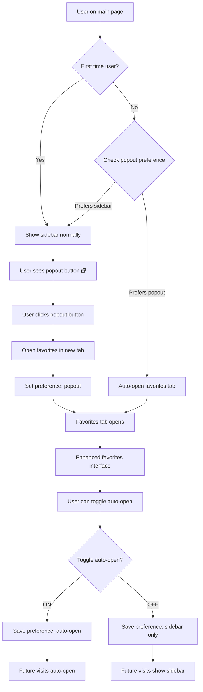

# 🌟 Favorites Popout Feature - Visual Mockup & Wireframes

## 📱 Current Sidebar (Before Enhancement)

```
┌─────────────────────────────────┐
│ Favorites (12)            Clear │
├─────────────────────────────────┤
│ [Filter favorites...]           │
├─────────────────────────────────┤
│ ⭐ hypertension                 │
│ → hipertensión              ✕   │
├─────────────────────────────────┤
│ ⭐ diabetes                     │
│ → diabetes                  ✕   │
├─────────────────────────────────┤
│ ⭐ medication                   │
│ → medicamento               ✕   │
└─────────────────────────────────┘
```

## 🔄 Enhanced Sidebar (With Popout Button)

```
┌─────────────────────────────────┐
│ Favorites (12)      🗗 Clear    │
├─────────────────────────────────┤
│ [Filter favorites...]           │
├─────────────────────────────────┤
│ ⭐ hypertension                 │
│ → hipertensión              ✕   │
├─────────────────────────────────┤
│ ⭐ diabetes                     │
│ → diabetes                  ✕   │
├─────────────────────────────────┤
│ ⭐ medication                   │
│ → medicamento               ✕   │
└─────────────────────────────────┘
```

**Changes:**
- Added `🗗` (popout) button next to "Clear" button
- Tooltip: "Open favorites in new tab"
- Maintains existing layout and functionality

## 🖥️ Dedicated Favorites Page Layout

### Desktop View (Full Screen)

```
┌─────────────────────────────────────────────────────────────────────────────┐
│ InterpAscend - My Favorites                                    [🏠] [⚙️] [✕] │
├─────────────────────────────────────────────────────────────────────────────┤
│                                                                             │
│  🌟 My Favorites (24 items)                                                │
│                                                                             │
│  ┌─────────────────────┐  ┌─────────────────┐  ┌─────────────────────────┐ │
│  │ [🔍 Search...]      │  │ [📊 Grid View]  │  │ [⚙️ Auto-open: ON/OFF] │ │
│  └─────────────────────┘  └─────────────────┘  └─────────────────────────┘ │
│                                                                             │
│  ┌─────────────────────────────────────────────────────────────────────┐   │
│  │ 📋 Actions: [✅ Select All] [🗑️ Delete Selected] [📤 Export]      │   │
│  └─────────────────────────────────────────────────────────────────────┘   │
│                                                                             │
│  ┌─────────────────────────────────────────────────────────────────────┐   │
│  │ ☐ ⭐ hypertension → hipertensión                              ✕    │   │
│  │    📍 Medical • Added 2 days ago • Used 5 times                    │   │
│  ├─────────────────────────────────────────────────────────────────────┤   │
│  │ ☐ ⭐ diabetes → diabetes                                      ✕    │   │
│  │    📍 Medical • Added 1 week ago • Used 12 times                   │   │
│  ├─────────────────────────────────────────────────────────────────────┤   │
│  │ ☐ ⭐ immigration → inmigración                                ✕    │   │
│  │    📍 Legal • Added 3 days ago • Used 3 times                      │   │
│  ├─────────────────────────────────────────────────────────────────────┤   │
│  │ ☐ ⭐ financial statement → estado financiero                  ✕    │   │
│  │    📍 Financial • Added 1 day ago • Used 1 time                    │   │
│  └─────────────────────────────────────────────────────────────────────┘   │
│                                                                             │
│  📊 Statistics: Most used domain: Medical (45%) • Total translations: 24   │
│                                                                             │
└─────────────────────────────────────────────────────────────────────────────┘
```

### Mobile View (Responsive)

```
┌─────────────────────────────────┐
│ ☰ My Favorites (24)        [✕] │
├─────────────────────────────────┤
│ [🔍 Search favorites...]        │
├─────────────────────────────────┤
│ [📊] [⚙️] [📤] [🗑️]            │
├─────────────────────────────────┤
│                                 │
│ ⭐ hypertension                 │
│ → hipertensión              ✕   │
│ 📍 Medical • 2d ago             │
│                                 │
├─────────────────────────────────┤
│                                 │
│ ⭐ diabetes                     │
│ → diabetes                  ✕   │
│ 📍 Medical • 1w ago             │
│                                 │
├─────────────────────────────────┤
│                                 │
│ ⭐ immigration                  │
│ → inmigración               ✕   │
│ 📍 Legal • 3d ago               │
│                                 │
└─────────────────────────────────┘
```

## 🎨 Design System Integration

### Color Scheme (Time-based Theming)

**Morning Theme (Beige #F5F5DC)**
```
┌─────────────────────────────────┐
│ 🌅 Light, warm colors           │
│ • Background: Soft beige        │
│ • Text: Dark charcoal           │
│ • Accents: Warm blues           │
└─────────────────────────────────┘
```

**Afternoon Theme (Light Blue #ADD8E6)**
```
┌─────────────────────────────────┐
│ ☀️ Bright, clear colors         │
│ • Background: Light blue        │
│ • Text: Dark navy               │
│ • Accents: Vibrant blues        │
└─────────────────────────────────┘
```

**Evening Theme (Light Steel Blue #B0C4DE)**
```
┌─────────────────────────────────┐
│ 🌆 Transitional colors          │
│ • Background: Steel blue        │
│ • Text: Dark slate              │
│ • Accents: Deeper blues         │
└─────────────────────────────────┘
```

**Night Theme (Charcoal #36454F)**
```
┌─────────────────────────────────┐
│ 🌙 Dark, comfortable colors     │
│ • Background: Dark charcoal     │
│ • Text: Light gray              │
│ • Accents: Bright blues         │
└─────────────────────────────────┘
```

## 🔄 User Flow Diagram



## 🎯 Key Features Highlighted

### 1. **Enhanced Search & Filtering**
- Real-time search across all favorite terms
- Filter by domain (Medical, Legal, Financial, etc.)
- Sort by date added, usage frequency, alphabetical

### 2. **Bulk Operations**
- Select multiple favorites with checkboxes
- Bulk delete selected items
- Export selected or all favorites

### 3. **Usage Analytics**
- Show how many times each term was accessed
- Display most-used domains
- Track when terms were added

### 4. **User Preferences**
- Toggle auto-open popout mode
- Choose between grid and list views
- Customize display options

### 5. **Cross-Tab Synchronization**
- Real-time updates across all open tabs
- Consistent state management
- Conflict resolution for simultaneous edits

## 📱 Responsive Behavior

### Desktop (≥768px)
- Full-featured interface with all options visible
- Grid or list view options
- Sidebar remains available on main site

### Tablet (768px - 1024px)
- Condensed toolbar with icon-only buttons
- Single-column layout
- Touch-friendly interactions

### Mobile (<768px)
- Simplified interface focusing on core functionality
- Stack layout for better thumb navigation
- Larger touch targets

## 🎨 Visual Enhancements

### Glassmorphism Effects
- Subtle backdrop blur on containers
- Semi-transparent backgrounds
- Soft shadows and borders

### Micro-interactions
- Smooth hover effects on favorite items
- Loading animations for operations
- Success/error feedback animations

### Accessibility Features
- High contrast mode support
- Keyboard navigation throughout
- Screen reader optimized markup
- Focus indicators on all interactive elements

This mockup provides a comprehensive visual guide for implementing the favorites popout feature while maintaining consistency with your existing design system and user experience patterns.